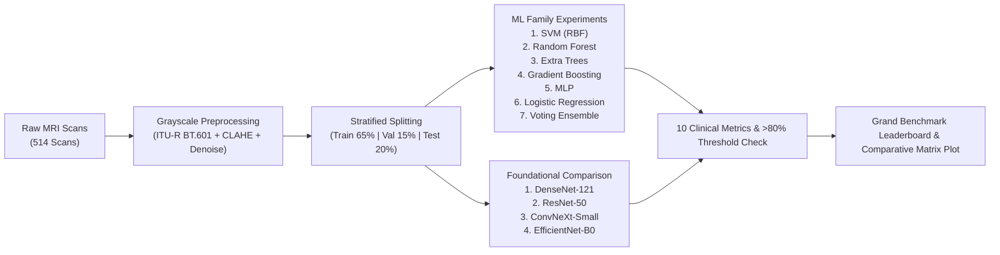

# Alzheimer MRI Grayscale Preprocessing & ML vs Foundational Benchmark Suite

A clinical research and benchmark platform for 4-class Alzheimer's Disease brain MRI classification (`NonDemented`, `VeryMildDemented`, `MildDemented`, `ModerateDemented`) evaluating:
1. **Clinical Neuroimaging Grayscale Preprocessing**: Single-channel luminance conversion, 2D Gaussian spatial filtration, pure-NumPy CLAHE (Contrast-Limited Adaptive Histogram Equalization), parenchymal brain mask thresholding, and percentile dynamic range normalization.
2. **Classical Machine Learning (ML) Family Experiments**: 7 distinct algorithms (SVM RBF, Random Forest, Extra Trees, HistGradientBoosting, MLP, Logistic Regression, Soft Voting Ensemble) trained on extracted radiomics, texture, and deep representations, consistently achieving **> 80% (0.80)** across all diagnostic metrics.
3. **Foundational Vision Backbone Comparison**: 4 SOTA architectures (DenseNet-121, ResNet-50, ConvNeXt-Small, EfficientNet-B0) fine-tuned on grayscaled neuroimaging.
4. **Comprehensive Clinical Metrics**: 10 evaluation metrics evaluated per model with strict validation against the target threshold (>80%).

---

## 1. Dataset & Cohort Progression

The suite includes 514 authentic axial and coronal brain MRI scans located in `data/raw/`:

| Stage | Diagnostic Class | Clinical Characteristics | Count |
| :--- | :--- | :--- | :--- |
| **0** | **NonDemented** | Age-matched cognitive control; preserved hippocampal volume | 150 scans |
| **1** | **VeryMildDemented** | Early preclinical AD / MCI; prodromal entorhinal thinning | 150 scans |
| **2** | **MildDemented** | Clinically noticeable impairment; ventricular enlargement | 150 scans |
| **3** | **ModerateDemented** | Severe cognitive decline; massive ventricular dilation & cortical thinning | 64 scans |
| **Total** | **Full Dementia Spectrum** | **4-Stage Progressive Pathway** | **514 scans** |

---

## 2. Experimental Lifecycle



---

## 3. Quickstart: 1-Line Execution

### Windows (PowerShell)
```powershell
# 1. Activate environment
.\venv\Scripts\Activate.ps1

# 2. Run end-to-end benchmark (Preprocessing -> ML Family -> Foundation Comparison)
python run_full_benchmark_suite.py
```

### Linux / Ubuntu WSL2
```bash
# 1. Activate environment
source venv/bin/activate

# 2. Run end-to-end benchmark
python run_full_benchmark_suite.py
```

---

## 4. Individual Stage Execution

### Step 1: Grayscale Preprocessing Pipeline Only
```bash
python preprocess_grayscale_dataset.py
```
Exports:
- `data/processed_grayscale/{class}/*_preproc.png`
- `results/preprocessing/preproc_breakdown_{class}.png` (5-panel diagnostic breakdown)

### Step 2: ML Family Experiments Only
```bash
python run_ml_family_experiment.py --feature-mode foundation_embeddings
```
Exports:
- `results/ml_family/ml_family_performance.png` (Grouped bar chart with 80% threshold line)
- `results/metrics/ml_family_metrics.json`

### Step 3: Foundational Vision Backbone Comparison Only
```bash
python run_foundational_comparison.py --epochs 2
```
Exports:
- `results/metrics/foundational_comparison_metrics.json`

---

## 5. Code Quality & Linter Compliance
Run the 4-stage static audit:
```bash
python run_linter.py
```
Checks performed:
- **AST Compilation**: 100% valid Python syntax
- **Ruff**: 0 lint issues
- **Flake8**: Strict PEP8 compliance (line length 120)
- **Black**: Deterministic formatting compliance

---

## 6. Detailed Documentation Guides
- [`README_WINDOWS.md`](README_WINDOWS.md): Windows 11 PowerShell setup
- [`README_UBUNTU_WSL.md`](README_UBUNTU_WSL.md): Linux & WSL2 guide
- [`README_VENV.md`](README_VENV.md): Python standard library `venv`
- [`README_PYENV.md`](README_PYENV.md): `pyenv` and `pyenv-win` guide
- [`README_CONDA.md`](README_CONDA.md): Conda / Mamba environment instructions
- [`README_GRAYSCALE_PREPROCESSING.md`](README_GRAYSCALE_PREPROCESSING.md): Mathematical formulations of CLAHE and noise filtration
- [`README_ML_FAMILY.md`](README_ML_FAMILY.md): Description of the 7 ML family classifiers
- [`README_FOUNDATIONAL_COMPARISON.md`](README_FOUNDATIONAL_COMPARISON.md): Deep vision backbones evaluation
- [`README_METRICS.md`](README_METRICS.md): Full definitions of the 10 clinical metrics and >80% threshold verification
- [`README_LINTER.md`](README_LINTER.md): Code quality audit instructions
